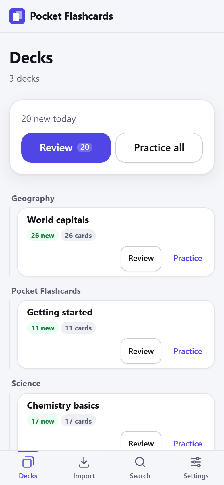
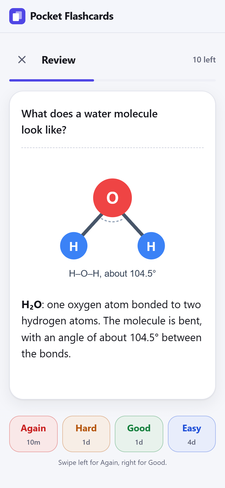
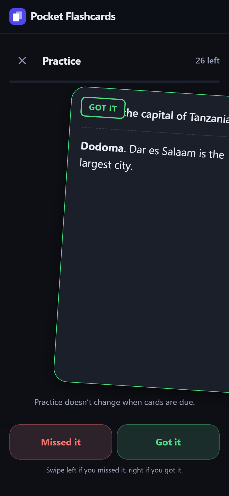

# Pocket Flashcards

[](https://github.com/IanHeinrich/pocket-flashcards/actions/workflows/ci.yml)

A flashcard app that keeps your cards on your own device. Decks are plain Markdown files, so you
can write them by hand or have an AI write them, and once it's installed it works offline.

I wanted flashcards for material I'd rather not upload to a hosted service, so there are no
accounts and nothing is sent anywhere.

<p align="center">
  
  
  
</p>

## Using it

Open <https://ianheinrich.github.io/pocket-flashcards/>. To install it on Android, open Chrome's
menu (⋮) and choose **Install app**. On a computer, use the install icon in the address bar of
Chrome or Edge.

The first time you open it you can load three example decks. To add your own, go to **Import**
and pick a file or paste the text.

There are two ways to study. **Review** is spaced repetition: you rate each card Again, Hard,
Good or Easy, and it comes back when it's due. **Practice** shuffles the cards and leaves the
schedule alone. On a phone, tap the card to see the answer and swipe right or left; on a
computer, use Space and the number keys.

## Writing a deck

```markdown
---
deck: Geography / World capitals
---

## What is the capital of Australia?

**Canberra**, not Sydney or Melbourne.

## France <-> Paris
```

Each `##` heading is the front of a card and the text under it is the back. A `<->` line makes a
card in each direction, and the `/` in the deck name groups decks together. Cards can also have
images and Mermaid diagrams.

[docs/deck-format.md](docs/deck-format.md) has the full format, plus a prompt you can give an AI
to write a deck on any topic.

## Your data

Decks, progress and images are stored in your browser's IndexedDB, and the app doesn't contact
any server but its own. The flip side is that nothing syncs: to move your progress to another
device, export a backup from **Settings** and import it there. Clearing the site's data in your
browser deletes everything, so keep a backup of anything you care about.

Images linked from other websites are off by default, because loading one tells that site you're
looking at the card. You can turn them on in Settings.

## Running your own copy

There's no build step: the repository is the site, and any static host can serve it. For GitHub
Pages, fork the repository and set **Settings → Pages → Source** to **GitHub Actions**. Every push
to `main` then deploys.

To work on it you need Node 20 or later:

```sh
npm install
npm run serve   # http://localhost:8080
npm test
```

[CONTRIBUTING.md](CONTRIBUTING.md) covers the other commands and how to send a change, and
[docs/architecture.md](docs/architecture.md) explains how the code fits together.

## License

[MIT](LICENSE)
