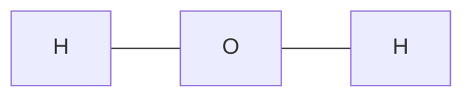
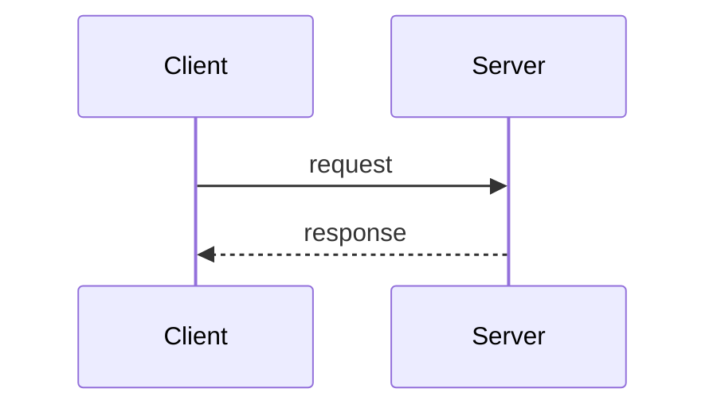

# Deck format

A deck is one Markdown file. It is easy to write by hand and easy to ask an
AI to generate. One file holds one deck.

````markdown
---
deck: Science / Chemistry basics
tags: [science, chemistry]
description: Symbols, units and a few reactions.
---

## What is the chemical symbol for sodium?

**Na**, from the Latin _natrium_.

## Avogadro's number <-> 6.022 × 10²³

## Water molecule

What does this diagram show?

---

A water molecule: one oxygen bonded to two hydrogens.


````

## Front matter

The file can start with a block between two `---` lines.

| Key           | Meaning                                                                                     |
| ------------- | ------------------------------------------------------------------------------------------- |
| `deck`        | The deck's name. Use `/` to group decks: `Science / Chemistry basics` sits under `Science`. |
| `tags`        | Optional. `[a, b]` or `a, b`. Practice can filter by tag.                                   |
| `description` | Optional. Shown on the deck page.                                                           |

Without front matter, a first-level heading (`# Name`) before the first
card names the deck. Without either, the file name is used (minus `.md`).

Importing a file whose deck name matches an existing deck updates that
deck. The name is matched after trimming and collapsing spaces, and case
matters.

## Cards

- Each `## heading` starts a card. The heading text is the **front**.
- Everything after it, up to the next `##` heading, is the **back**.
- To put more than one line on the front, such as a diagram or an image,
  add a line containing only `---` inside the card. Everything above it is
  front, everything below it is back, and the heading becomes the first
  line of the front.
- `## A <-> B` makes two cards, A → B and B → A, with nothing below the
  heading. Use it for terms and definitions you want to know both ways.
- A `##` inside a fenced code block does not start a card.
- Text before the first `##` (other than the `#` deck name) is ignored, so
  you can leave notes to yourself there.

### Identity and progress

A card is identified by its deck and its front. Re-importing an edited deck:

- keeps the review history of every card whose front is unchanged,
  even if you fixed its back,
- adds cards with new fronts as new cards,
- offers to remove cards whose front is no longer in the file.

Rewording a front therefore makes it a new card. Two cards in one deck with
the same front are reported, and only the first is kept.

## Formatting

Fronts and backs support a safe subset of Markdown:

- `**bold**`, `_italic_` or `*italic*`, `` `code` ``
- bulleted (`-`) and numbered (`1.`) lists, one level of nesting
- `> quotes`, `### headings` (levels 3 to 6), `---` rules on the back
- fenced code blocks with ` ``` `
- links: `[text](https://example.com)`
- images and diagrams, below

A line break in your text is kept on the card, so write each paragraph on
one line and use a blank line between paragraphs.

HTML in a deck is shown as text, never run.

## Images

```markdown

```

- **Relative paths** refer to image files you import with the deck. Select
  the `.md` file and its images together in the import screen. Images are
  matched by path, and then by file name, so `images/a.png` matches a
  selected `a.png`. The preview lists any that are missing. Imported images
  are stored on the device with the deck.
- **`data:image/...` URIs** work anywhere, including pasted text.
- **`https://` images** are blocked by default, because loading one sends a
  request to that server and tells it you are looking at the card. You can
  turn them on in Settings.

## Diagrams

A fenced code block tagged `mermaid` is drawn as a diagram, on the front
or the back:

````markdown

````

See the [Mermaid documentation](https://mermaid.js.org/intro/) for the
diagram types. If a diagram has an error, the card shows its source
instead.

## Asking an AI to make a deck

Paste this into any AI chat, fill in the topic, and import the reply.

````text
Make a flashcard deck about <TOPIC> in this exact Markdown format.

Rules:
- Start with front matter:
  ---
  deck: <Group> / <Deck name>
  tags: [tag1, tag2]
  ---
- Each card starts with "## " followed by the question (the front).
- The answer (the back) goes on the lines below, until the next "## ".
- For a term you should know both ways, write a single line
  "## Term <-> Definition" with nothing under it.
- To put a diagram or extra lines on the front, add a line "---" inside
  the card: above it is the front, below it the back.
- Diagrams go in ```mermaid fenced blocks.
- Keep each back short: one idea, a sentence or a short list.
- Write each paragraph on one line; line breaks are kept on the card.
- Use **bold** for the key word of the answer.
- Write <NUMBER> cards. Reply with only the deck, in one code block.
````
