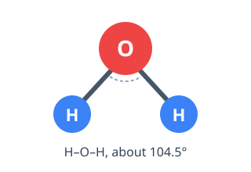
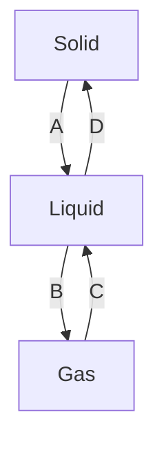

## What is the chemical symbol for sodium?

**Na**, from the Latin _natrium_.

## What is the chemical symbol for gold?

**Au**, from the Latin _aurum_.

## What is the chemical symbol for potassium?

**K**, from the Latin _kalium_.

## Hydrogen <-> Atomic number 1

## What does the atomic number of an element count?

The number of **protons** in the nucleus. It decides which element an atom is.

## What is the chemical formula of table salt?

**NaCl**: sodium chloride, one sodium ion for each chloride ion.

## What does a water molecule look like?

**H₂O**: one oxygen atom bonded to two hydrogen atoms. The molecule is bent, with an angle of about 104.5° between the bonds.

## Which change of state does each arrow show?

---

- **A**: melting
- **B**: evaporation (boiling, when it happens throughout the liquid)
- **C**: condensation
- **D**: freezing

## What is the difference between an ionic and a covalent bond?

- **Ionic**: one atom gives electrons to another, and the opposite charges attract.
- **Covalent**: atoms share electrons.

## What does it mean to balance a chemical equation?

Each element has the same number of atoms on both sides, because atoms are not created or destroyed in a reaction. For example, 2H₂ + O₂ → 2H₂O.

## Why are the noble gases (group 18) so unreactive?

Their outer electron shell is full, so they have little tendency to gain, lose or share electrons.

## What pH does a neutral solution have at 25 °C?

**7**. Below 7 is acidic, and above 7 is basic (alkaline).

## What is a mole?

The amount of a substance that contains 6.022 × 10²³ particles, such as atoms or molecules.

## Avogadro's number <-> 6.022 × 10²³ per mole

## What is the molar mass of water?

About **18 g/mol**: two hydrogens at about 1 g/mol each, plus one oxygen at about 16 g/mol.
