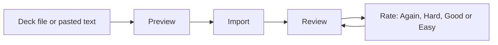

## How do you see the back of a card during review?

Tap **Show answer**. The back appears, and the rating buttons appear under it.

## What do the four rating buttons do?

You rate how well you remembered the card:

- **Again**: you forgot it. It comes back in about 10 minutes.
- **Hard**: you got it, with effort. It comes back after a short wait.
- **Good**: you remembered it. It comes back after a longer wait.
- **Easy**: no effort at all. It comes back after the longest wait.

Each button shows when the card will return.

## Why does a card you rate Again come back in the same session?

So you see it again while it is fresh. A forgotten card is put back a few cards later in the queue. Once you rate it Good or Easy, it moves on to longer waits.

## Spaced repetition <-> Reviewing a card just before you would forget it

## What does a `<->` heading do?

`## Term <-> Definition` makes two cards from one line: Term to Definition, and Definition to Term. Use it for pairs you want to know in both directions. The line has nothing under it.

## How do you put a diagram or an image on the front of a card?

Add a line containing only three dashes (`---`) inside the card. Everything above it, including the heading, is the front. Everything below it is the back.

## What is the path from a deck file to a review?

This card's back is a diagram. A code block tagged `mermaid` is drawn as one, on the front or the back.

## How do images work in a deck?

Write ``. Select the `.md` file and its images together when you import, and the images are stored on your device with the deck. Images from the web (`https://`) are blocked unless you turn them on in Settings, because loading one tells that server you are looking at the card.

## What happens when you import an edited deck?

The deck is matched by name. Cards whose front is unchanged keep their review history, even if you fixed their back. A card with a new front is a new card. The preview shows what will be added, changed or removed before you confirm.

## How do you keep a backup of your progress?

Open **Settings** and choose **Export backup**. To restore it on this or another device, choose **Import backup**. Your cards live only on this device, and clearing the site's data in your browser deletes them, so export a backup now and then. Nothing syncs automatically.
